<div align="center">

# Smart Attendance System

### AI-Powered Attendance Management with Face Recognition & Voice Biometrics

An intelligent attendance management application built with Python and Streamlit, combining facial recognition, voice-based identification, and dedicated teacher and student dashboards.

[](https://www.python.org/)
[](https://streamlit.io/)
[](#-ai--ml-capabilities)
[](https://supabase.com/)

**[View Repository](https://github.com/muskxann/AI-attendance)**

</div>

---

## 📌 Overview

Traditional attendance systems often depend on manual roll calls, paper registers, or time-consuming administrative processes.

**Smart Attendance** explores how artificial intelligence and biometric recognition can simplify this process.

The application provides separate interfaces for teachers and students. Teachers can manage subjects, initiate AI-assisted attendance, and review attendance records. Students can enroll in courses, authenticate through the available identification workflows, and monitor their attendance statistics.

The project integrates machine learning pipelines, biometric feature extraction, database operations, and an interactive web interface into one application.

### Highlights

* Facial recognition using facial embeddings and a trained classifier.
* Voice-based attendance using speaker embeddings.
* Dedicated teacher and student portals.
* Subject creation and enrollment.
* Attendance records and student statistics.
* Interactive Streamlit interface.
* Modular code organization for UI, database operations, and AI pipelines.

---

## ✨ Features

### 👨‍🏫 Teacher Portal

* **Registration and Login:** Create a teacher profile and authenticate.
* **Subject Management:** Create subjects with subject codes and sections.
* **Enrollment Codes:** Share subject codes with students.
* **AI Attendance:** Select a subject and add photographs for attendance analysis.
* **Voice Attendance:** Access the voice-based attendance workflow.
* **Attendance Records:** Review recorded sessions, timestamps, subjects, and attendance statistics.
* **Student Overview:** View student enrollment counts for individual subjects.

### 🎓 Student Portal

* **Student Authentication:** Register and log in to the application.
* **Face ID Login:** Access the facial identification workflow.
* **Subject Enrollment:** Enroll in subjects using enrollment codes.
* **Enrolled Subjects:** View registered courses and their details.
* **Attendance Statistics:** Track total classes and attended classes.
* **Course Management:** Unenroll from subjects when necessary.

### 🤖 AI-Powered Attendance

**Facial Recognition**

* Processes photographs through a dedicated face pipeline.
* Extracts facial embeddings.
* Uses a trained classifier to support student identification.

**Voice-Based Attendance**

* Processes voice input through a dedicated voice pipeline.
* Uses Resemblyzer for speaker embedding extraction.
* Supports speaker-related feature processing.

### 🎨 User Interface

* Custom lavender, pink, and deep-purple theme.
* Reusable interface components.
* Dedicated dashboards for teachers and students.
* Subject cards and interactive forms.
* Attendance tables and statistics.
* Password visibility controls.
* Navigation between application workflows.

---

## 🖼️ Application Screenshots

The application features a custom-designed interface for authentication, subject management, biometric attendance, and attendance tracking.

### 1. Welcome Screen

The landing page provides separate entry points for teachers and students.

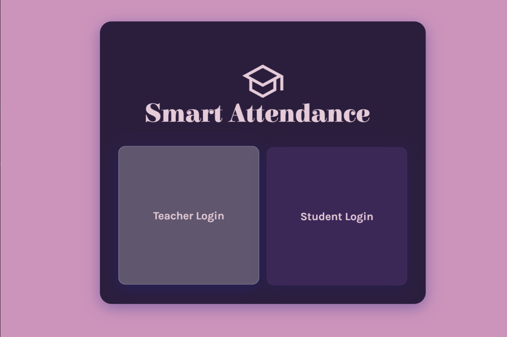

### 2. Teacher Registration

Teachers can create an account using their username, full name, and password.

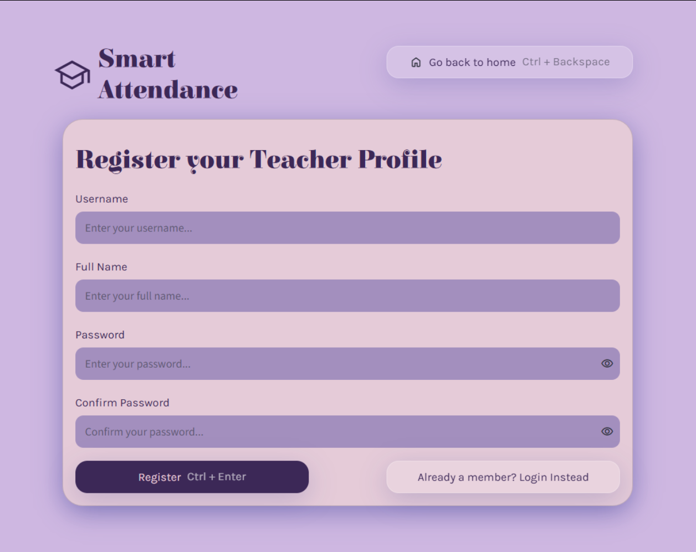

### 3. Teacher Login

Registered teachers can securely access the teacher portal using their credentials.

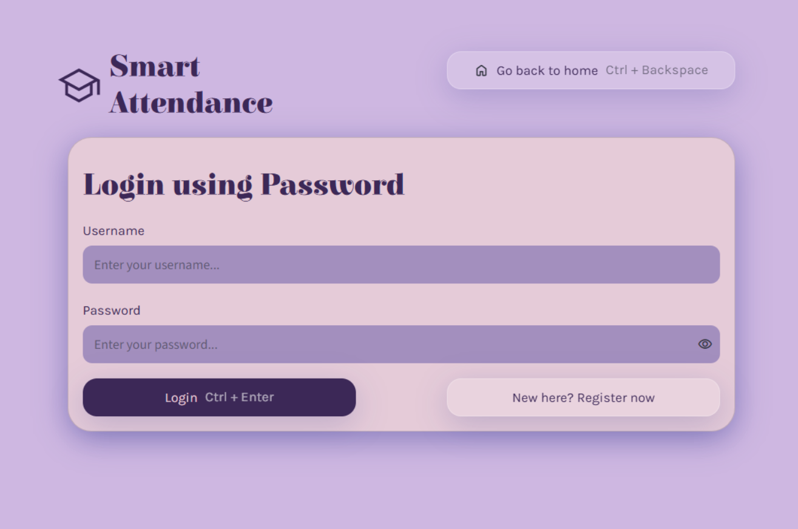

### 4. Teacher Dashboard

The teacher dashboard provides access to attendance taking, subject management, and attendance records.

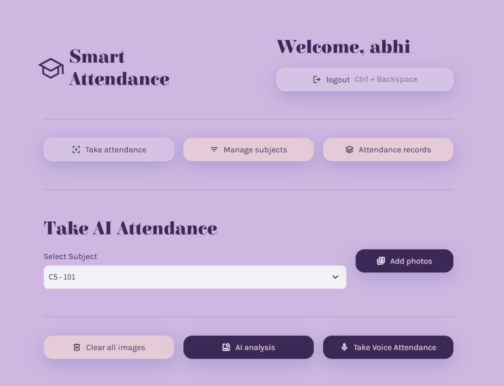

### 5. Subject Management

Teachers can create subjects, share enrollment codes, and monitor enrollment information.

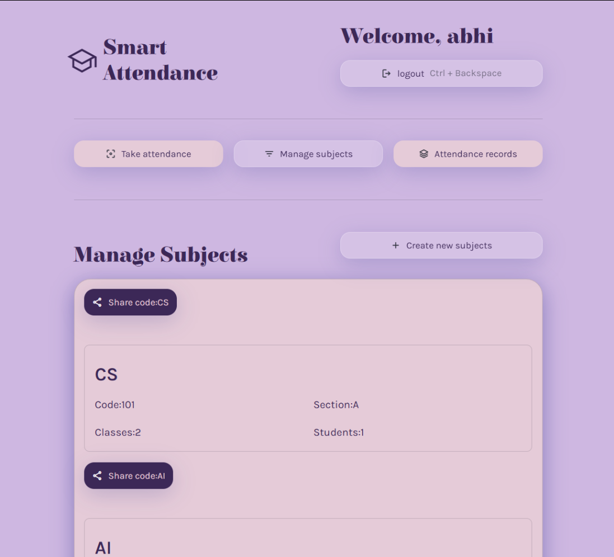

### 6. Attendance Records

Review recorded attendance sessions, including timestamps, subject names, subject codes, and attendance statistics.

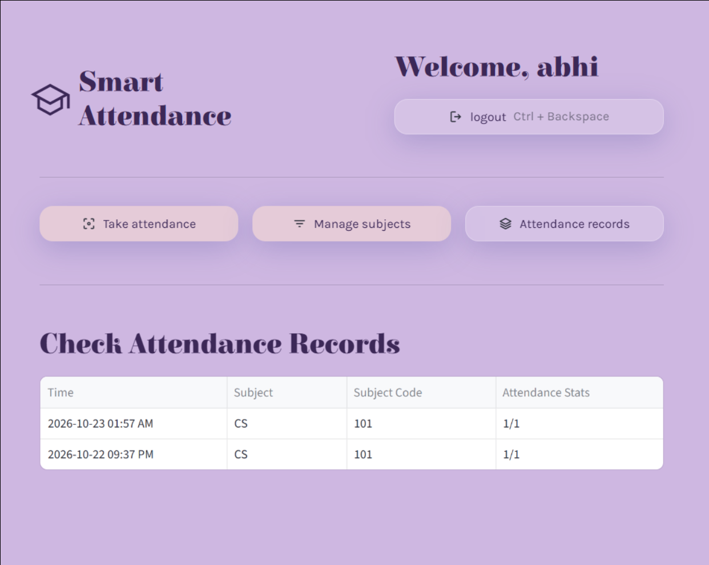

### 7. Student Login

The student authentication interface provides access to the student portal.

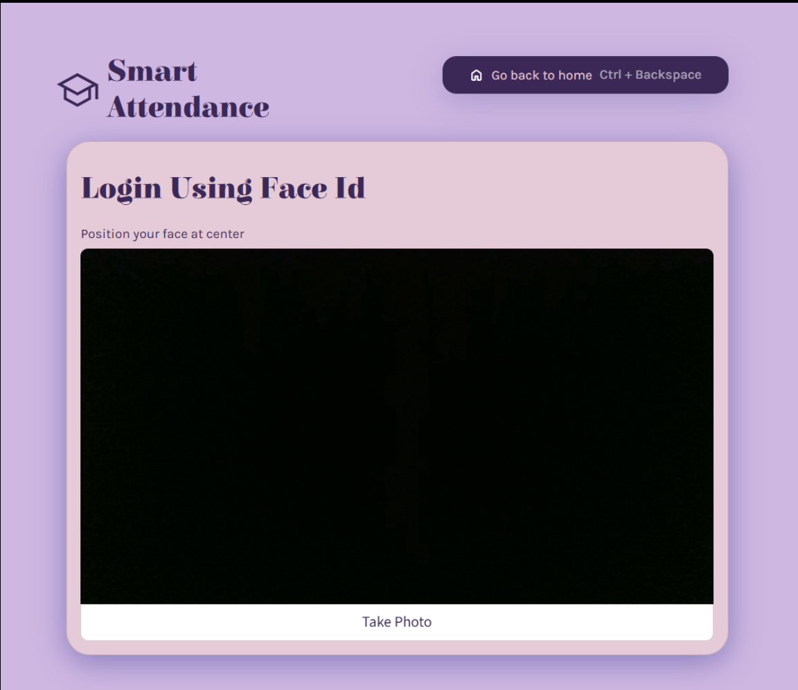

### 8. Face ID Login

The facial identification interface provides a camera-based workflow for student identification.


### 9. Student Dashboard

Students can view enrolled subjects, course codes, sections, total classes, and attended classes.

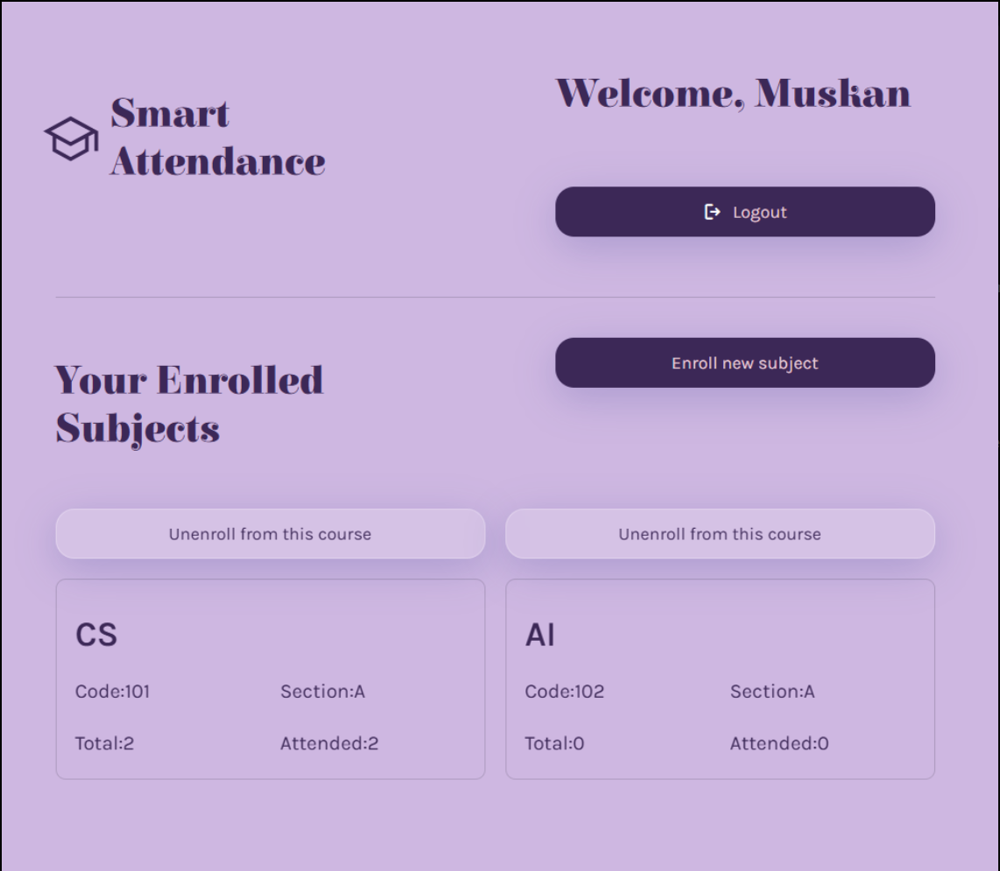

### 10. AI Attendance

The AI attendance interface allows teachers to select a subject, add photographs, and initiate attendance analysis.

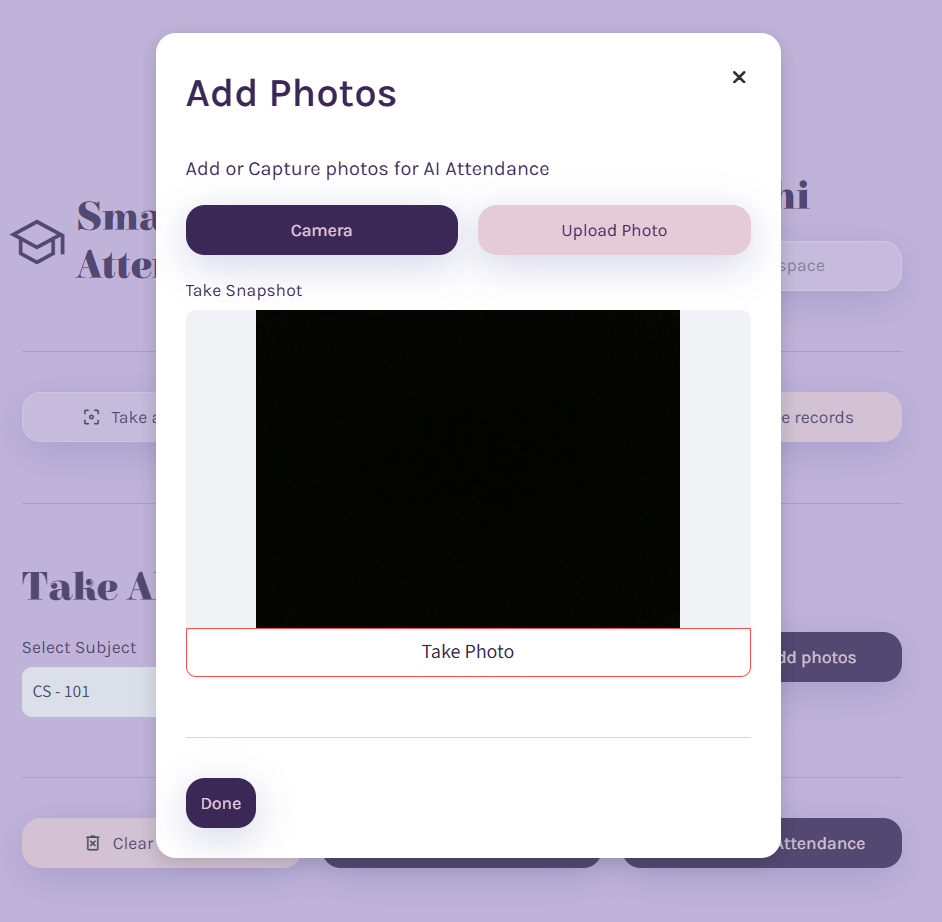

### 11. AI Analysis

The AI analysis interface supports the facial recognition attendance workflow.

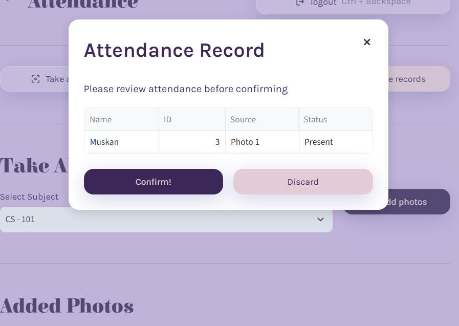

### 12. Voice Attendance

The application includes a separate workflow for voice-based attendance using speaker-related features.

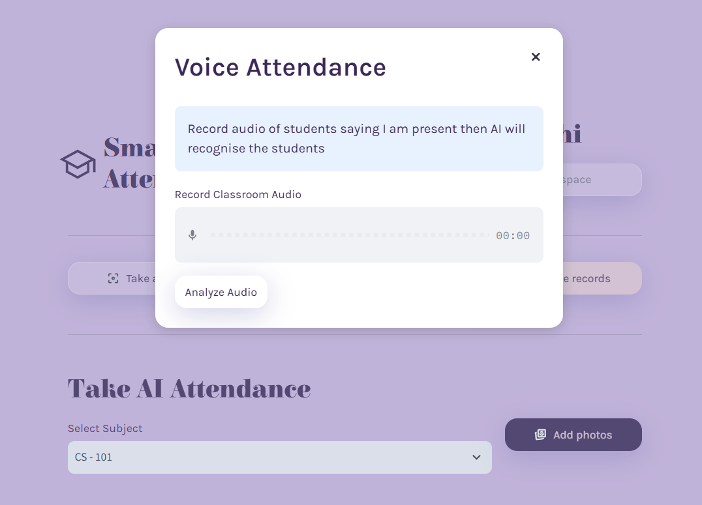

### 13. Database Integration

Database configuration and operations form part of the application's backend.

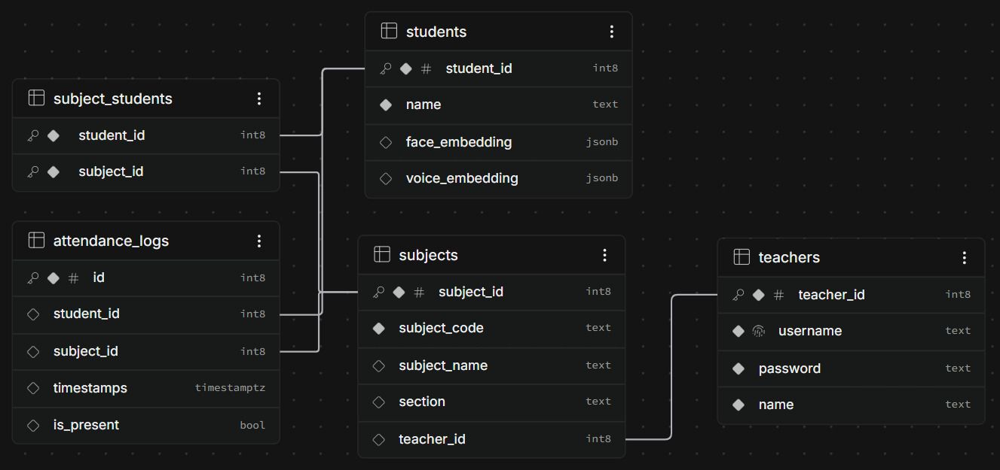

---

## 🧠 AI & ML Capabilities

The project integrates machine learning pipelines into an attendance management application.

### Facial Recognition Pipeline

The face pipeline processes facial information and uses embeddings with a trained classifier to support identification.

```text
Student Photographs
        |
        v
Face Processing Pipeline
        |
        v
Facial Embedding Extraction
        |
        v
Trained Classifier
        |
        v
Student Identification
        |
        v
Attendance Processing
```

Facial embeddings are numerical representations of features extracted from facial images. A trained classifier can use these representations to distinguish between enrolled individuals.

### Voice Recognition Pipeline

The voice pipeline uses Resemblyzer to extract speaker embeddings from audio.

```text
Voice Input
     |
     v
Audio Processing
     |
     v
Speaker Embedding Extraction
     |
     v
Speaker Identification
     |
     v
Attendance Processing
```

Speaker embeddings represent characteristics of a voice numerically and can support comparisons between speakers.

The precise recognition logic and matching thresholds depend on the implemented pipeline.

### Why Two Biometric Modalities?

| Aspect                 | Facial Recognition            | Voice Recognition                          |
| ---------------------- | ----------------------------- | ------------------------------------------ |
| Input                  | Images                        | Audio                                      |
| Feature representation | Facial embeddings             | Speaker embeddings                         |
| Main pipeline          | Face processing               | Voice processing                           |
| Potential limitations  | Lighting, pose, image quality | Noise, microphone quality, voice variation |

The application provides separate face and voice workflows. This does not necessarily mean both modalities are combined for every attendance event.

---

## 🏗️ System Architecture

The application separates its interface, application workflows, AI pipelines, and database operations into distinct components.

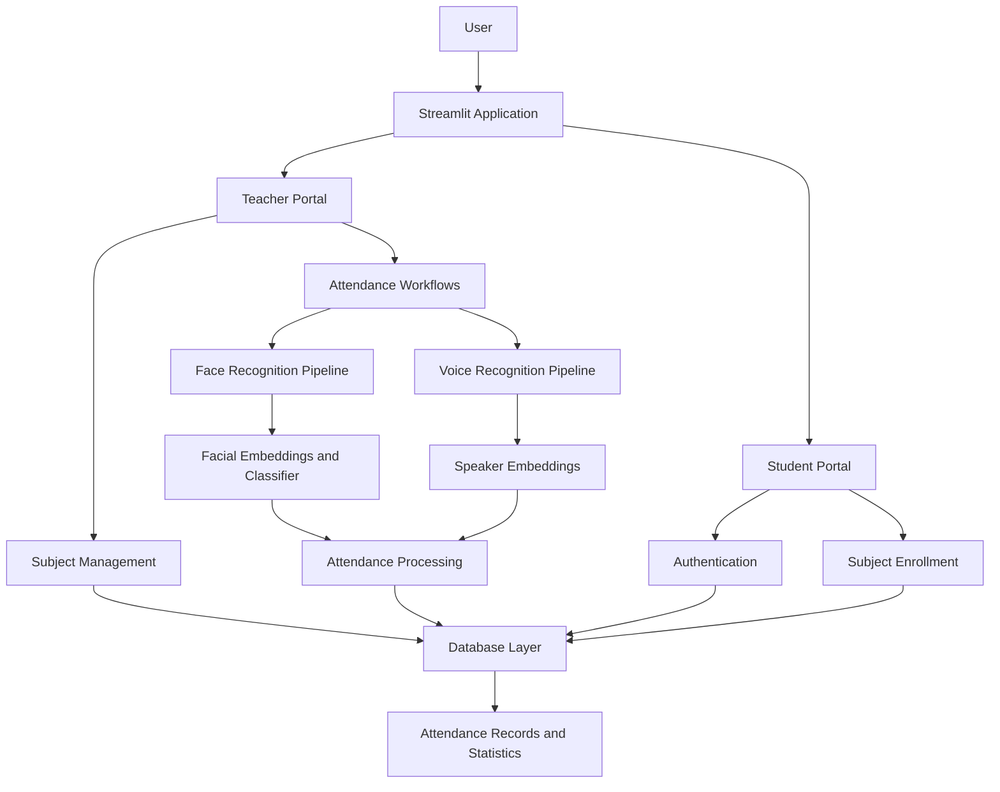

### Main Components

| Component           | Responsibility                                     |
| ------------------- | -------------------------------------------------- |
| Streamlit interface | Renders forms, buttons, pages, and dashboards      |
| Teacher portal      | Subject and attendance management                  |
| Student portal      | Authentication, enrollment, and attendance viewing |
| Face pipeline       | Facial feature processing and classification       |
| Voice pipeline      | Speaker embedding extraction                       |
| Database layer      | Persistent application data operations             |
| Attendance records  | Displays recorded sessions and statistics          |

---

## 🛠️ Tech Stack

| Technology                  | Purpose                                      |
| --------------------------- | -------------------------------------------- |
| Python                      | Core application language                    |
| Streamlit                   | Interactive web interface                    |
| NumPy                       | Numerical operations                         |
| Pillow (PIL)                | Image processing and handling                |
| Resemblyzer                 | Speaker embedding extraction                 |
| Facial recognition pipeline | Facial feature processing and identification |
| Trained classifier          | Classification of facial embeddings          |
| Supabase                    | Database and backend integration             |
| Git and GitHub              | Version control and collaboration            |

*The precise dependency versions and database implementation should be verified against the current source code and dependency files.*

---

## 📁 Project Structure

The project separates the interface, reusable components, database operations, and AI processing pipelines.

```text
AI-attendance/
│
├── app.py
├── requirements.txt
├── .gitignore
│
├── assets/
│   ├── home-screen.png
│   ├── register-teacher.png
│   ├── login-teacher.png
│   ├── take-attendance.png
│   ├── manage-subjects.png
│   ├── attendance-records.png
│   ├── student-login.png
│   ├── student-dashboard.png
│   ├── ai-attendance.png
│   ├── ai-analysis.png
│   ├── voice-attendance.png
│   └── db.png
│
└── src/
    ├── components/
    ├── database/
    ├── pipelines/
    ├── screens/
    └── ui/
```

*This is a high-level representation. Keep the actual filenames and directories in your repository as they are.*

### Code Organization

* **`src/components/`**: Reusable UI components and subject-related dialogs.
* **`src/database/`**: Database connection and data access functions.
* **`src/pipelines/`**: Facial and voice processing logic.
* **`src/screens/`**: Application screens and user workflows.
* **`src/ui/`**: Styling and layout utilities.
* **`app.py`**: Application entry point.
* **`requirements.txt`**: Python dependencies.
* **`assets/`**: Application screenshots and visual resources.

---

## 🚀 Getting Started

Follow these steps to run the application locally.

### Prerequisites

* Python version compatible with the project's dependencies.
* Git.
* A configured database and backend connection.
* A webcam for camera-based functionality.
* A microphone for voice-based attendance.

Some machine learning dependencies may require additional system libraries.

### 1. Clone the Repository

```bash
git clone https://github.com/muskxann/AI-attendance.git
cd AI-attendance
```

### 2. Create a Virtual Environment

**Windows PowerShell**

```powershell
python -m venv .venv
.\.venv\Scripts\Activate.ps1
```

**macOS / Linux**

```bash
python3 -m venv .venv
source .venv/bin/activate
```

### 3. Install Dependencies

```bash
python -m pip install --upgrade pip
pip install -r requirements.txt
```

If a dependency fails to install, verify your Python version and the package's operating-system requirements.

### 4. Configure Environment Variables

If your database configuration uses environment variables, create a `.env` file in the project root.

For example:

```env
SUPABASE_URL=your_supabase_project_url
SUPABASE_KEY=your_supabase_key
```

Use the exact variable names expected by your database code. These names are examples and should be verified against your implementation.

**Security reminder:** Never commit database credentials, passwords, API keys, or private biometric data to GitHub. Add `.env` to `.gitignore`.

### 5. Run the Application

From the project root, execute:

```bash
streamlit run app.py
```

Open the local address displayed in your terminal to access the application.

---

## ⚙️ Configuration

Before using the application, verify the following:

### Database

* Configure the database connection.
* Confirm that the required tables and schema exist.
* Test database read and write operations.
* Apply appropriate permissions to protect student and teacher records.

### Facial Recognition

* Install the required image-processing and recognition dependencies.
* Ensure the embedding extraction and classifier components are available.
* Enroll the individuals who need to be recognized.
* Test recognition with representative images.

### Voice Recognition

* Install the required audio-processing dependencies.
* Verify microphone access.
* Ensure suitable enrollment or reference data is available.
* Test the voice pipeline with clear audio.

Specific setup requirements depend on the implementation and configuration files in the repository.

---

## 🔄 How It Works

### Teacher Workflow

1. Register or log in to the teacher portal.
2. Create a subject with its code and section.
3. Share the enrollment code with students.
4. Select a subject for attendance.
5. Add photographs or use the voice attendance workflow.
6. Initiate the corresponding attendance process.
7. Review attendance records and statistics.

### Student Workflow

1. Register or log in to the student portal.
2. Enroll in subjects using their enrollment codes.
3. View enrolled courses on the dashboard.
4. Use the available facial identification workflow when required.
5. Review attendance statistics for enrolled subjects.

### Attendance Records

The teacher-facing records page displays information such as:

* Attendance timestamp.
* Subject name.
* Subject code.
* Attendance statistics.

The student dashboard displays course-specific totals and attended-class counts.

---

## 🔐 Security & Privacy

Biometric information requires careful handling.

Recommended practices include:

* **Credential protection:** Keep application secrets outside source control.
* **Authentication:** Protect teacher and student accounts.
* **Database permissions:** Restrict access to authorized records.
* **Biometric data protection:** Secure facial images, facial embeddings, audio recordings, and speaker embeddings.
* **Consent:** Inform users about biometric data collection and obtain appropriate consent.
* **Retention:** Establish clear policies for deleting biometric information.
* **Secure deployment:** Use encrypted connections and appropriate access controls.

Facial and speaker embeddings should be treated as sensitive biometric data even when they are stored as numerical representations.

These are recommended safeguards, not claims that every control is already implemented.

---

## 🔮 Future Improvements

Potential enhancements include:

* **Liveness Detection:** Help prevent identification using photographs or replayed media.
* **Multimodal Verification:** Combine facial and voice evidence in a properly evaluated verification workflow.
* **Attendance Analytics:** Add monthly summaries and subject-wise trends.
* **Recognition Confidence:** Introduce confidence thresholds and manual review.
* **Duplicate Prevention:** Prevent multiple attendance entries for the same student and class session.
* **Automated Testing:** Add tests for authentication, database operations, and biometric pipelines.
* **Responsive Interface:** Improve usability across laptops, tablets, and mobile devices.
* **Deployment:** Document a secure deployment process.
* **Audit Logging:** Track attendance modifications and important administrative actions.

These are proposed improvements, not existing features unless implemented separately.

---

## 🤝 Contributing

Contributions, bug reports, and suggestions are welcome.

1. Fork the repository.

2. Create a feature branch.

   ```bash
   git checkout -b feature/your-feature
   ```

3. Implement and test your changes.

4. Commit your work.

   ```bash
   git add .
   git commit -m "feat: describe your change"
   ```

5. Push your branch.

   ```bash
   git push origin feature/your-feature
   ```

6. Open a pull request describing your changes.

---

## 👩‍💻 Author

**Muskan Mundra**

Electronics & Instrumentation Engineering Student | AI/ML Developer

Interested in machine learning, intelligent applications, and building practical AI-powered systems.

* **GitHub:** [@muskxann](https://github.com/muskxann)
* **Project:** [Smart Attendance System](https://github.com/muskxann/AI-attendance)

---

<div align="center">

### Making attendance smarter, one classroom at a time.

**Built with Python, Streamlit, and AI/ML.**

If you find this project interesting, consider giving the repository a ⭐.

</div>
